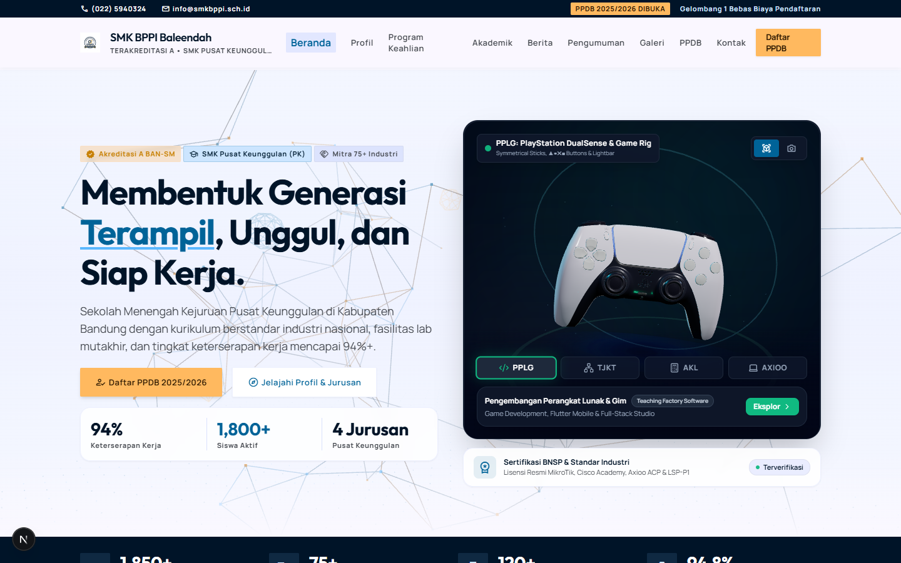
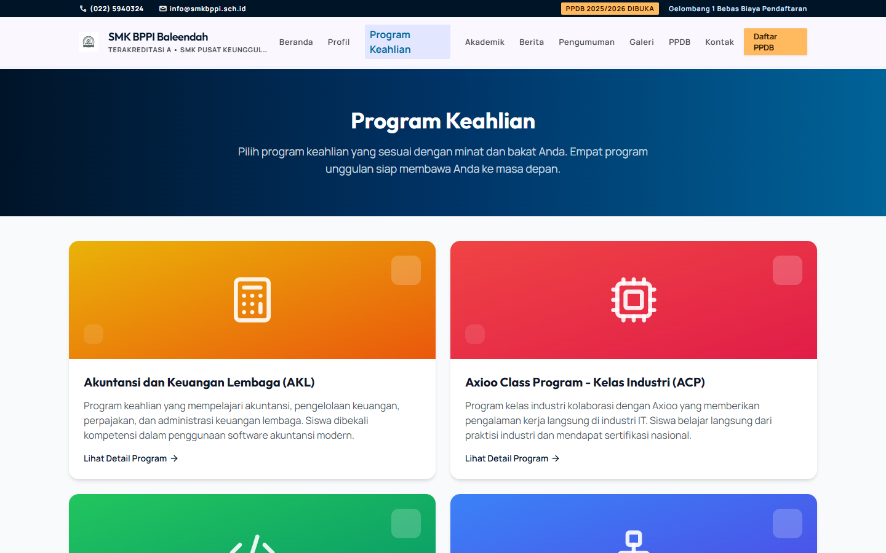
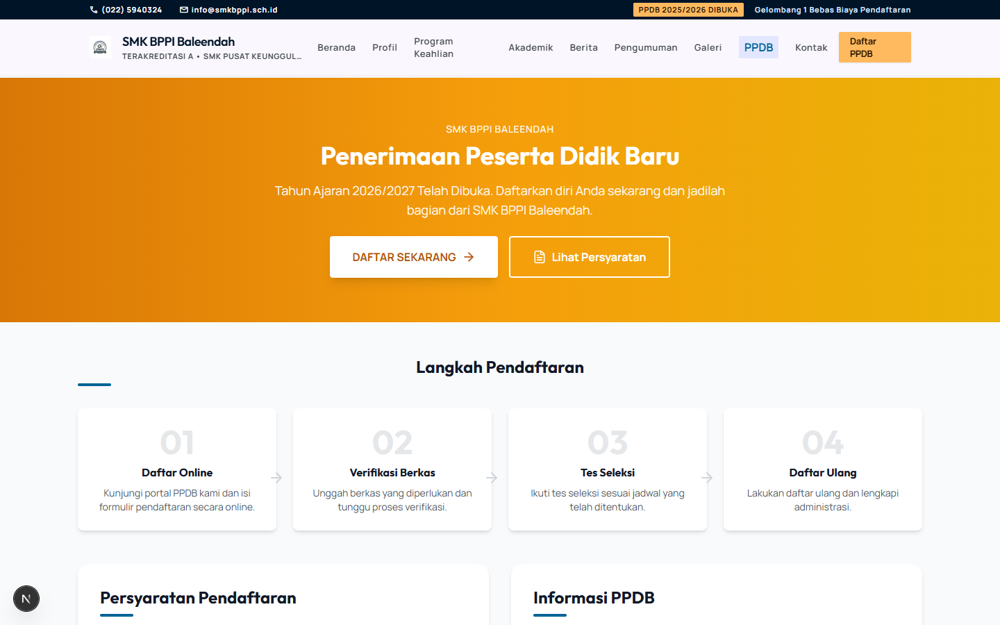
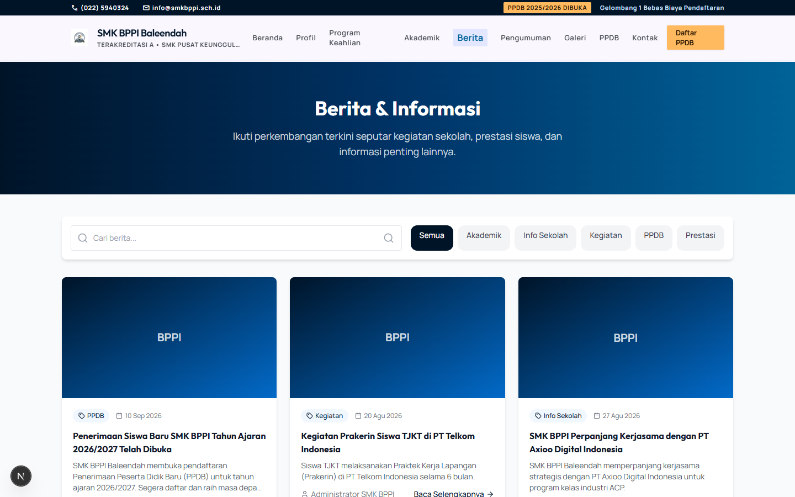
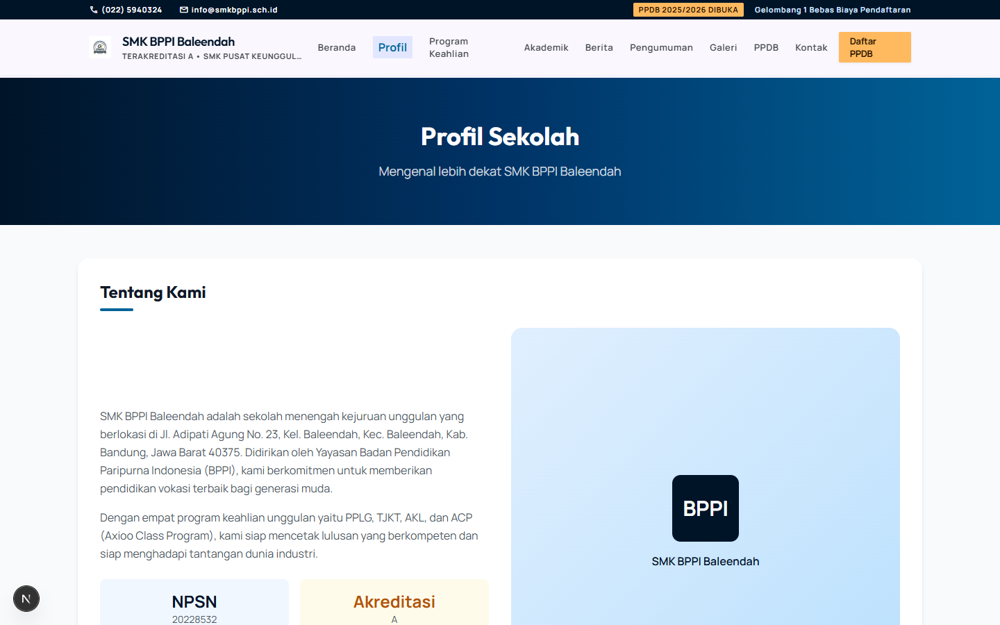
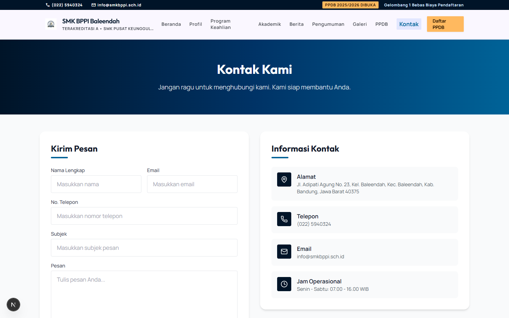

# Website SMK BPPI Baleendah

Website sekolah (Next.js 15 App Router + TypeScript + Tailwind + Prisma/SQLite) dengan panel admin untuk mengelola berita, pengumuman, jurusan, galeri, dan pesan masuk.

Dokumentasi lengkap: [DOKUMENTASI_TEKNIS_DAN_PANDUAN.md](./DOKUMENTASI_TEKNIS_DAN_PANDUAN.md)

## Preview

| Beranda | Program Keahlian |
| --- | --- |
|  |  |

| PPDB | Berita & Pengumuman |
| --- | --- |
|  |  |

| Profil Sekolah | Kontak |
| --- | --- |
|  |  |

## Fitur

- Halaman publik: beranda, profil, program keahlian, berita, pengumuman, galeri, PPDB, kontak
- Panel admin (`/admin`): kelola berita, pengumuman, jurusan, galeri, dan pesan masuk
- Formulir kontak tersimpan ke database via API route
- Hero 3D interaktif (three.js + Spline) dengan fallback ringan
- SEO: `sitemap.xml`, `robots.txt`, metadata per halaman

## Stack

- Next.js 15 (App Router, React 19)
- TypeScript
- Tailwind CSS 3 (design token Material 3, `next-themes` terpasang; palet dark belum diimplementasi)
- Prisma 5 + SQLite
- three.js / Spline (hero 3D background)

## Getting Started

```bash
git clone <repo-url>
cd smk-bppi-website
npm install

cp .env.example .env   # lalu isi NEXTAUTH_SECRET dengan random string
npx prisma generate
npx prisma db push    # buat schema database
npm run db:seed       # isi data awal + akun admin
npm run dev
```

Buka http://localhost:3000. Panel admin: `/admin/login`.

> Tidak ada password admin default. `npm run db:seed` membuat password acak dan
> menampilkannya di terminal — simpan baik-baik. Butuh nilai sendiri? Set
> `ADMIN_SEED_PASSWORD` di `.env` sebelum seed. Ganti password sebelum deploy.

## Scripts

| Script | Fungsi |
| --- | --- |
| `npm run dev` | Dev server |
| `npm run build` / `npm start` | Production build & serve |
| `npm run lint` | ESLint |
| `npm run db:push` | Push schema Prisma ke database |
| `npm run db:seed` | Seed data awal |
| `npm run db:reset` | Reset + seed ulang |
| `npm run db:studio` | Prisma Studio (GUI database) |

## Environment Variables

| Key | Keterangan |
| --- | --- |
| `DATABASE_URL` | Koneksi database, default `file:./database.db` |
| `NEXTAUTH_SECRET` | Kunci signing session admin. **Wajib random di produksi** |
| `NEXTAUTH_URL` | URL aplikasi |
| `ADMIN_SEED_PASSWORD` | Opsional. Password akun admin saat seed. Kosong = acak |

Lihat `.env.example`. File `.env` dan `database.db` tidak di-commit.
